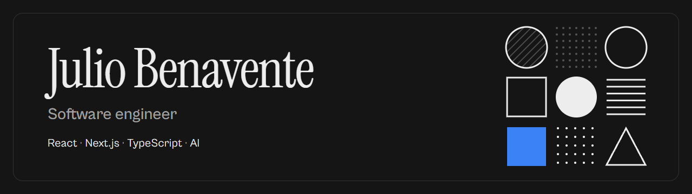
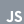

<picture>
  <source media="(prefers-color-scheme: dark)" srcset="banner-light.webp">
  <source media="(prefers-color-scheme: light)" srcset="banner-charcoal.webp">
  
</picture>

### Hi there, I'm Julio 👋 💻

## I'm a Software Engineer

I ship production products with React and Next.js, think beyond the deadline, and speak up early when a decision will cost us later. I'm currently leading frontend at Fusion 360, building a marketing platform in TypeScript, Next.js and Tailwind CSS.

Before that I built websites at Square Agency, full stack registration APIs with face and ID verification at Solera, and client dashboards at GCC Networking. I hold a B.S. in Computer Science from Western Governors University (2026) and I'm working toward an M.S. in Artificial Intelligence and Machine Learning (expected 2027).

Always learning, and happiest when the whole team gets stronger.

## Connect with me

  &nbsp;&nbsp;&nbsp;
  &nbsp;&nbsp;&nbsp;
  &nbsp;&nbsp;&nbsp;
  

## Languages and tools

<h4> Frontend</h4>

  &nbsp;&nbsp;&nbsp;
  &nbsp;&nbsp;&nbsp;
  &nbsp;&nbsp;&nbsp;
  &nbsp;&nbsp;&nbsp;
  &nbsp;&nbsp;&nbsp;
  &nbsp;&nbsp;&nbsp;
  &nbsp;&nbsp;&nbsp;
  &nbsp;&nbsp;&nbsp;
  &nbsp;&nbsp;&nbsp;
  &nbsp;&nbsp;&nbsp;
  

<h4> Backend</h4>

  &nbsp;&nbsp;&nbsp;
  &nbsp;&nbsp;&nbsp;
  &nbsp;&nbsp;&nbsp;
  &nbsp;&nbsp;&nbsp;
  &nbsp;&nbsp;&nbsp;
  &nbsp;&nbsp;&nbsp;
  

<h4> AI</h4>

  &nbsp;&nbsp;&nbsp;
  &nbsp;&nbsp;&nbsp;
  &nbsp;&nbsp;&nbsp;
  &nbsp;&nbsp;&nbsp;
  

<h4> Other</h4>

  &nbsp;&nbsp;&nbsp;
  

